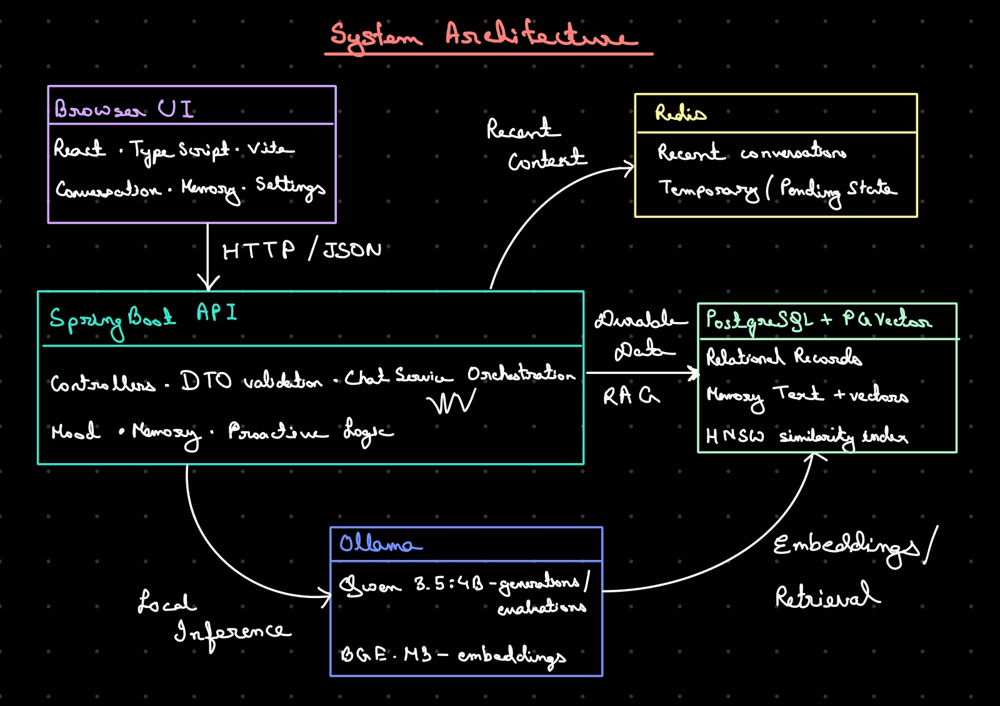
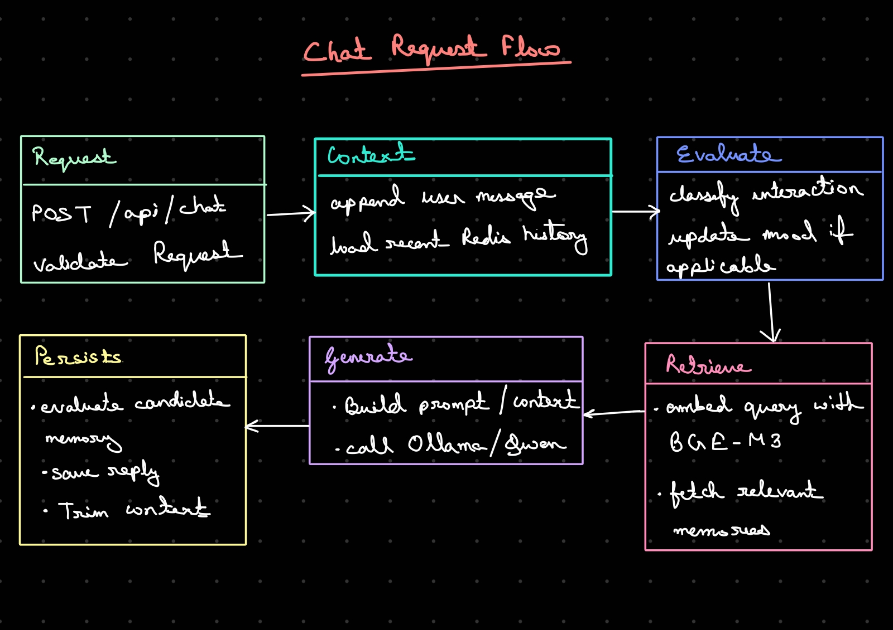
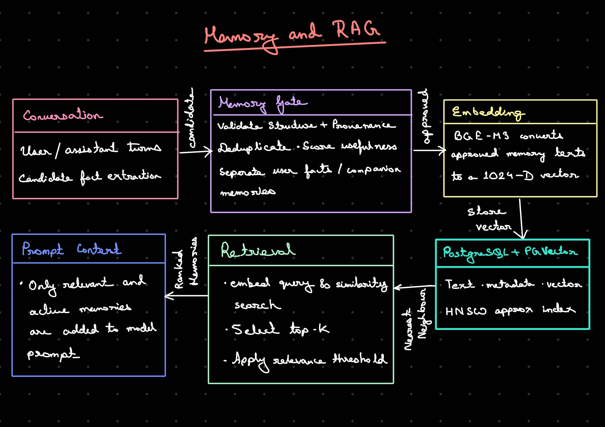
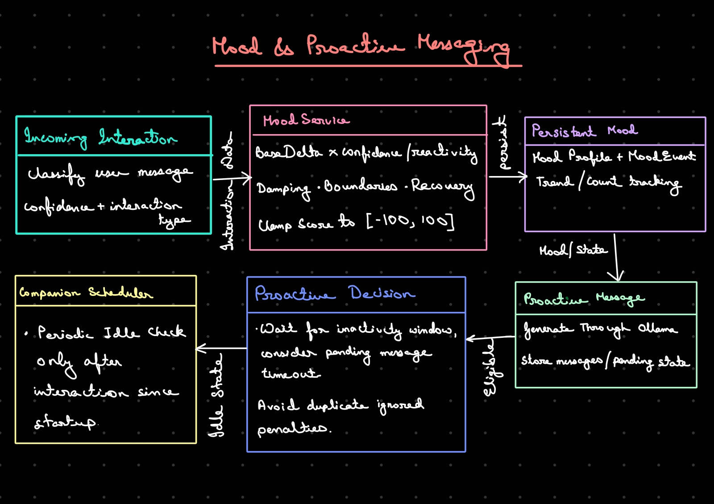
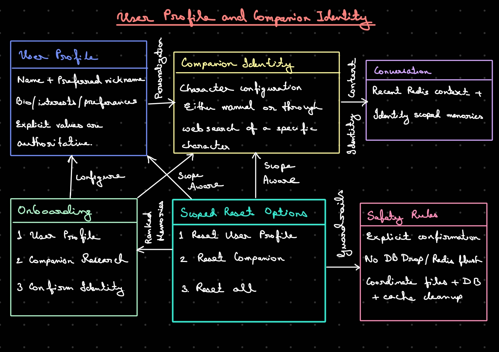

# AI Companion

A local, single-user AI companion with a React chat interface and a Spring Boot
backend. PostgreSQL stores durable profiles, identities, conversations, and
memories; Redis provides the short-term conversation cache; Ollama runs the
language and embedding models locally.

## Architecture











### Runtime components

- **Frontend:** React, TypeScript, Vite, Tailwind CSS, and Lucide icons. The
  Vite development server proxies `/api` to the backend at port `8080`.
- **Backend:** Java 17+, Spring Boot MVC, Jakarta validation, Spring Data JPA,
  Hibernate, Flyway, and scheduled tasks.
- **PostgreSQL + pgvector:** durable user profile and facts, companion
  identities, portrait metadata, conversation history, memories, and vector
  embeddings. Embeddings have 1,024 dimensions.
- **Redis:** a bounded `conversation` list used as recent prompt context. The
  application trims it to 200 entries; PostgreSQL remains the durable source
  for conversation history.
- **Ollama:** local inference using `qwen3.5:4b` for language tasks and
  `bge-m3` for embeddings. Both model names are currently configured in the
  backend source.
- **Portrait files:** validated PNG files are stored outside the database in a
  configurable directory (default `backend/data/companion-portraits/`).

### Database schema initialization

Flyway runs before Hibernate. V1 creates the user-profile and personal-fact
tables. V2 removes the legacy `relationships` column only when an older
`companion_identity` table and that column already exist; on a fresh database,
that table is created afterward from the current JPA entity, which no longer
contains the field. Hibernate `ddl-auto=update` currently creates/updates the
other JPA-managed tables and their entity-declared foreign keys. The Docker
PostgreSQL initialization script enables pgvector before Flyway/Hibernate
startup; for native PostgreSQL, create the `vector` extension before starting
the backend. HNSW indexes are optional manual indexes documented below. If a
database already recorded the previous V2 checksum, run Flyway `repair` with
that deployment's configured connection before starting the updated
application. Repair updates migration metadata without rerunning the already
applied column removal.

The chat flow loads the active companion identity and user profile, builds
recent context, evaluates the message and mood, retrieves relevant memories,
optionally searches the web when enabled, and asks Ollama to generate a reply.
Conversation messages are saved to PostgreSQL and cached in Redis. While the
Conversation view is open, the frontend checks persisted history every five
seconds so scheduled proactive messages appear without a reload.

Memory retrieval embeds the query with BGE-M3 and uses pgvector cosine distance.
The repository does **not** create HNSW indexes through a migration yet. The
setup below provides optional HNSW index commands to run after the backend has
created its tables.

### Review conversation-suggested facts

After each chat turn, Ollama evaluates the user's latest message and may suggest
a durable personal fact. Suggestions appear in **Memory → Personal Facts** as
proposed items; they are not automatically treated as confirmed facts or
included in companion prompts. Review each suggestion using the available
actions:

- **Correct** edits the wording; the edited fact remains proposed for review.
- **Confirm** approves the fact and makes it available in companion prompts.
- **Reject** records that the fact should not be used.
- **Delete** removes the fact.

Facts added manually in this section also start as proposed, so confirm them
before expecting the companion to use them. This review queue is separate from
the `/api/memories` long-term memory store used for vector similarity retrieval;
conversation suggestions do not automatically create entries in that store.

### Data and identity behavior

- Onboarding requires a user profile and an active companion identity before
  Conversation is enabled.
- Companion identity stores name, personality, background, history, speech
  style, values, and an optional portrait reference. It has no relationships
  field.
- Character research returns an identity draft; review it before saving.
- Personal facts are stored separately from companion identity and support
  proposed, confirmed, and rejected states; conversation suggestions are
  reviewed in Settings before they are included in companion prompts.
- Conversation history is stored per companion identity in PostgreSQL.
- Reset Companion preserves the user profile; Reset My Profile preserves the
  companion identity; Reset Everything removes the saved user and companion
  data in the application's reset scope.
- Uploaded portrait files are not committed to Git. For container/cloud
  deployments, mount the configured portrait directory on persistent storage.

## Requirements

- Git
- Docker Engine on Linux, or Docker Desktop on Windows/macOS
- For native development without Compose: Java 17+, Node.js 20.19+ or
  22.12+ (a current supported LTS release), and Ollama installed on the host

The recommended Compose setup runs PostgreSQL/pgvector, Redis, Ollama, the
backend, and frontend in containers; it does not require Java, Node.js, or a
host Ollama installation. GPU acceleration is optional. Before starting
Compose, install the GPU vendor's supported host drivers and container runtime
support if you want Ollama to use a GPU: NVIDIA users need NVIDIA Container
Toolkit; AMD users need a ROCm-supported Linux setup and AMD device passthrough.
The supplied Compose configuration currently enables NVIDIA GPUs only; see
the GPU section below before attempting to use an AMD GPU.

## Install prerequisites

Use the commands for your operating system. If a package is already installed,
skip that command. Linux commands below target Ubuntu 24.04; other distributions
may use different package names.

### Linux (Debian/Ubuntu)

```bash
sudo apt update
sudo apt install -y git curl ca-certificates openjdk-17-jdk
```

Install NVM and a compatible Node.js LTS release:

```bash
curl -o- https://raw.githubusercontent.com/nvm-sh/nvm/v0.40.3/install.sh | bash
```

Open a new terminal, then run:

```bash
nvm install 22
nvm use 22
```

On Ubuntu 24.04, install the packaged Docker Engine and start it:

```bash
sudo apt install -y docker.io
sudo systemctl enable --now docker
sudo usermod -aG docker "$USER"
```

Log out and back in so the new group membership takes effect, then verify:

```bash
docker run --rm hello-world
```

Membership in the `docker` group grants root-equivalent control of the machine.
If you do not want that, omit the `usermod` command and prefix Docker commands
with `sudo`.

### macOS

Install Homebrew if it is not already available, then install Java, Node, and
Git:

```bash
brew install --cask temurin@17
brew install node git
brew install --cask docker
open -a Docker
```

Wait until Docker Desktop reports that its engine is running.

### Windows (PowerShell)

Install Java, Node.js LTS, and Git with `winget`:

```powershell
winget install --id EclipseAdoptium.Temurin.17.JDK -e
winget install --id OpenJS.NodeJS.LTS -e
winget install --id Git.Git -e
winget install --id Docker.DockerDesktop -e
```

Open a new PowerShell window after installation, launch Docker Desktop from the
Start menu, and wait until its engine is running.

### Check prerequisite versions

Run these in a new terminal:

```text
java -version
node --version
npm --version
docker --version
```

Java must be 17 or newer. Node must be 20.19+ or 22.12+.

## Get the source

Clone the repository (or open the project directory you already have):

```bash
git clone https://github.com/TasRuhani/AI-Companion.git
cd AI-Companion
```

The project has two applications:

```text
backend/   Spring Boot API
frontend/  React + TypeScript + Vite
```

## Run the full application with Docker Compose

This is the recommended way to run all services together. Compose starts
PostgreSQL with pgvector, Redis, Ollama, downloads the configured models into a
persistent Ollama volume, builds the Spring Boot API, and builds the React UI
served by Nginx. Java, Maven, and Node.js are installed inside the build
containers; only Git and Docker are needed on the host.

### GPU acceleration in Docker Compose

GPU acceleration is optional. Install the vendor-specific host driver and
container support before starting Compose, and follow the matching subsection.
The current `docker-compose.yml` configures NVIDIA GPU access only. Docker
Desktop GPU support and GPU passthrough on Windows/macOS differ from native
Linux and are not configured by this project.

#### NVIDIA GPUs on Linux

The `ollama` service requests all NVIDIA GPUs through Compose (`gpus: all`).
The NVIDIA driver alone is not sufficient: Docker also needs NVIDIA Container
Toolkit configured as its runtime. This project host uses Linux Mint 22.2,
based on Ubuntu 24.04, and has an RTX 3060; `nvidia-smi` confirms the host
driver/GPU. If the toolkit has not been installed, run these commands on the
host (administrator access required), following NVIDIA's
[Container Toolkit installation guide](https://docs.nvidia.com/datacenter/cloud-native/container-toolkit/latest/install-guide.html):

```bash
curl -fsSL https://nvidia.github.io/libnvidia-container/gpgkey \
  | sudo gpg --dearmor -o /usr/share/keyrings/nvidia-container-toolkit-keyring.gpg
curl -s -L https://nvidia.github.io/libnvidia-container/stable/deb/nvidia-container-toolkit.list \
  | sed 's#deb https://#deb [signed-by=/usr/share/keyrings/nvidia-container-toolkit-keyring.gpg] https://#g' \
  | sudo tee /etc/apt/sources.list.d/nvidia-container-toolkit.list
sudo apt update
sudo apt install -y nvidia-container-toolkit
sudo nvidia-ctk runtime configure --runtime=docker
sudo systemctl restart docker
```

Restarting Docker stops and restarts its containers. Confirm the runtime can
see the GPU before launching the application (the first command downloads a
CUDA diagnostic image):

```bash
docker run --rm --gpus all nvidia/cuda:12.4.1-base-ubuntu22.04 nvidia-smi
```

The output should show the host GPU. Then recreate the Ollama container with
GPU access:

```bash
docker compose up -d --force-recreate ollama
docker compose logs --tail=100 ollama
```

After a chat request has run inference, verify Ollama reports GPU placement:

```bash
docker compose exec ollama ollama ps
nvidia-smi
```

`ollama ps` reports the processor placement for loaded models; it should show
GPU use (for example, `100% GPU` or a CPU/GPU split). If Docker reports
`could not select device driver "" with capabilities: [[gpu]]`, the NVIDIA
Container Toolkit is missing or Docker was not restarted after configuration.

#### AMD GPUs on Linux

AMD acceleration is **not enabled by the supplied Compose configuration**.
Install a host driver/ROCm version supported by your AMD GPU and Linux
distribution, following AMD's
[ROCm installation guide](https://rocm.docs.amd.com/projects/install-on-linux/en/latest/).
The Ollama container must also use a ROCm-capable image and be granted access to
the required AMD devices (commonly `/dev/kfd` and `/dev/dri`). Those image and
device settings are not present in this project's Compose file, so installing
ROCm alone will not enable AMD acceleration here. Do not add NVIDIA's
`gpus: all` setting as an AMD substitute; the Compose service needs a separate
ROCm configuration.

Copy the root environment template:

**Linux/macOS**

```bash
cp .env.example .env
```

**Windows PowerShell**

```powershell
Copy-Item .env.example .env
```

Edit `.env` and replace `DB_PASSWORD` with a strong local password. Then, from
the repository root:

```bash
docker compose up --build -d
```

The first startup downloads the Ollama and application images, builds the
frontend/backend, and downloads `qwen3.5:4b` and `bge-m3`; allow time and disk
space for these downloads. The backend waits for PostgreSQL, Redis, and model
downloads before starting. Check status and logs:

```bash
docker compose ps
docker compose logs -f backend
```

Open `http://localhost:5173`. The frontend's Nginx server forwards `/api`
requests to the backend. For direct API access, the backend is also available
at `http://localhost:8080`; PostgreSQL and Redis are bound to loopback on ports
5432 and 6379.

Verify the database extension and Redis:

```bash
docker compose exec postgres psql -U companion_app -d companion -c "SELECT extversion FROM pg_extension WHERE extname = 'vector';"
docker compose exec redis redis-cli ping
```

Create optional HNSW indexes after the application tables exist:

```bash
docker compose exec postgres psql -U companion_app -d companion
```

At the `psql` prompt:

```sql
CREATE INDEX IF NOT EXISTS idx_memories_embedding_hnsw
    ON memories USING hnsw (embedding vector_cosine_ops)
    WHERE embedding IS NOT NULL;
CREATE INDEX IF NOT EXISTS idx_profile_facts_embedding_hnsw
    ON profile_facts USING hnsw (embedding vector_cosine_ops)
    WHERE embedding IS NOT NULL;
\q
```

Stop containers while preserving data:

```bash
docker compose down
```

Start again with `docker compose up -d`. PostgreSQL, Redis, Ollama models, and
portraits persist in named volumes. **`docker compose down -v` deletes those
volumes and all data in them; only run it if you intentionally want to erase
the local database, cached Redis state, model downloads, and portraits.**

Web search is off by default. To enable it, set `WEB_SEARCH_ENABLED=true` and
add a valid `TAVILY_API_KEY` to the root `.env`, then recreate the backend:

```bash
docker compose up -d --build backend
```

### Docker Compose services and volumes

| Service | Purpose | Host address |
| --- | --- | --- |
| `frontend` | Production-built React app served by Nginx; proxies `/api` | `http://localhost:5173` |
| `backend` | Spring Boot API | `http://localhost:8080` |
| `postgres` | PostgreSQL 16 with pgvector enabled at initialization | `localhost:5432` |
| `redis` | Redis append-only cache | `localhost:6379` |
| `ollama` | Local LLM and embedding API | Internal Compose network |
| `ollama-models` | One-shot download of both configured models | Runs to completion |

Named volumes: `postgres-data`, `redis-data`, `ollama-data`, and
`portrait-data`. The Compose stack publishes network ports only on `127.0.0.1`.
If a port is already in use, change its corresponding `POSTGRES_PORT`,
`REDIS_PORT`, `BACKEND_PORT`, or `FRONTEND_PORT` value in `.env` before
starting the stack.

## Native Ollama setup (without Docker Compose)

Install Ollama on the host:

- **Linux:** `curl -fsSL https://ollama.com/install.sh | sh`
- **macOS:** `brew install ollama`
- **Windows:** `winget install --id Ollama.Ollama -e`

Start its service if the installer did not start it:

- **Linux:** `sudo systemctl enable --now ollama` (if installed as a system
  service). Otherwise run `ollama serve` in a separate terminal.
- **macOS:** open the Ollama app. If it is not running, run `ollama serve` in a
  separate terminal.
- **Windows:** open the Ollama app. If it is not running, run `ollama serve`
  from PowerShell.

Pull the models used by this source tree:

```bash
ollama pull qwen3.5:4b
ollama pull bge-m3
ollama list
```

Keep Ollama running when using the native backend. Its API defaults to
`http://localhost:11434`; override `OLLAMA_BASE_URL` when needed.

## Native PostgreSQL and Redis setup (without Docker Compose)

Create named volumes so database and Redis files survive container recreation:

```bash
docker volume create companion-postgres-data
docker volume create companion-redis-data
```

Start a PostgreSQL 16 container that includes the pgvector extension. Replace
the example administrator password with a strong local value before running
the command:

```bash
docker run -d --name companion-postgres --restart unless-stopped -e POSTGRES_USER=postgres -e POSTGRES_PASSWORD=replace-with-a-local-admin-password -e POSTGRES_DB=postgres -p 127.0.0.1:5432:5432 -v companion-postgres-data:/var/lib/postgresql/data pgvector/pgvector:pg16
```

Start Redis, bound to loopback so it is not exposed to the local network:

```bash
docker run -d --name companion-redis --restart unless-stopped -p 127.0.0.1:6379:6379 -v companion-redis-data:/data redis:7-alpine redis-server --appendonly yes
```

The `docker run` commands above are single-line commands and work in Bash,
PowerShell, and Command Prompt. The example administrator password is for local
setup only; do not reuse it for a deployed service.

Check the containers:

```bash
docker ps
```

```bash
docker exec companion-redis redis-cli ping
```

The expected response is `PONG`. Verify pgvector is installed after creating
the database as described next.

### Create the application database and role

Open the PostgreSQL prompt as its administrator:

```bash
docker exec -it companion-postgres psql -U postgres -d postgres
```

At the `psql` prompt, create a dedicated login, set its password interactively,
create the database, connect to it, and enable pgvector:

```sql
CREATE ROLE companion_app WITH LOGIN;
\password companion_app
CREATE DATABASE companion OWNER companion_app;
\c companion
CREATE EXTENSION IF NOT EXISTS vector;
\dx
\q
```

When `\password` prompts, use a strong local password and save it for the
backend configuration. The pgvector extension must exist before the backend
creates its vector columns.

Verify that the extension is installed:

```bash
docker exec companion-postgres psql -U postgres -d companion -c "SELECT extversion FROM pg_extension WHERE extname = 'vector';"
```

### Optional: create HNSW indexes

Start the backend once using the next section so Hibernate can create the
application tables, then stop it. Reconnect to the database:

```bash
docker exec -it companion-postgres psql -U postgres -d companion
```

Create cosine-distance HNSW indexes on memory and profile-fact embeddings:

```sql
CREATE INDEX IF NOT EXISTS idx_memories_embedding_hnsw
    ON memories USING hnsw (embedding vector_cosine_ops)
    WHERE embedding IS NOT NULL;

CREATE INDEX IF NOT EXISTS idx_profile_facts_embedding_hnsw
    ON profile_facts USING hnsw (embedding vector_cosine_ops)
    WHERE embedding IS NOT NULL;

\di
\q
```

These indexes are a manual database optimization, not a Flyway migration in the
current repository. Run the commands again for each new database after its
tables are created. HNSW is optional; vector search works without these indexes.

## Configure and run the backend natively

From the repository root, copy the example configuration:

**Linux/macOS**

```bash
cp backend/.env.example backend/.env
```

**Windows PowerShell**

```powershell
Copy-Item backend/.env.example backend/.env
```

Edit `backend/.env` and set the dedicated database credentials:

```properties
DB_USERNAME=companion_app
DB_PASSWORD=the-password-entered-for-companion_app
```

For native execution, the example file contains the local Redis/PostgreSQL addresses and portrait
settings. It is ignored by Git; never commit `.env` files, API keys, or other
credentials. Web search is optional and disabled by default. To enable it, set:

```properties
WEB_SEARCH_ENABLED=true
TAVILY_API_KEY=your-tavily-key
```

Start Spring Boot from the `backend` directory so its optional `.env` import
and default relative portrait path resolve as documented:

**Linux/macOS**

```bash
cd backend
./mvnw spring-boot:run
```

**Windows PowerShell**

```powershell
cd backend
.\mvnw.cmd spring-boot:run
```

On first startup, Flyway applies the database migrations and Hibernate creates
the existing application tables. The API listens on `http://localhost:8080`.
Verify that it started:

```bash
curl http://localhost:8080/api/settings/onboarding
```

Before onboarding, the response's `nextStep` is `USER_PROFILE`. If startup
fails, check that PostgreSQL, Redis, and Ollama are running and that the
credentials in `backend/.env` match the database role.

Run backend tests from `backend/`:

```bash
./mvnw test
```

On Windows use `.\mvnw.cmd test`.

## Install and run the frontend natively

Open another terminal at the repository root:

```bash
cd frontend
npm install
npm run dev
```

On Windows PowerShell, the same `npm` commands work. Open the URL printed by
Vite, normally `http://localhost:5173`. Keep the backend and Ollama running in
their own terminals/services. Vite proxies requests under `/api` to
`http://localhost:8080`; a proxy `ECONNREFUSED` error means the backend is not
accepting connections at that address.

Complete the user profile and companion identity setup in the UI before
starting a conversation. Build the frontend for production with:

```bash
npm run build
```

## API overview

All routes are served by the Spring Boot backend under `/api`.

| Method | Route | Purpose |
| --- | --- | --- |
| `POST` | `/chat` | Send a chat message |
| `GET` | `/chat/history` | Load persisted history for the active identity |
| `GET` | `/companion/identity` | Read the active companion identity |
| `POST` | `/companion/initialize` | Create the companion identity |
| `PUT` | `/companion/identity` | Edit the active identity |
| `POST` | `/companion/research` | Research an identity draft |
| `POST` | `/companion/identity/{id}/portrait` | Upload or replace a PNG portrait |
| `GET` | `/companion/identity/{id}/portrait` | Retrieve a portrait |
| `DELETE` | `/companion/identity/{id}/portrait` | Remove a portrait |
| `GET` | `/settings/onboarding` | Read profile and identity setup status |
| `GET`, `PUT` | `/settings/profile` | Read or update the user profile |
| `GET`, `POST`, `PUT`, `PATCH`, `DELETE` | `/settings/personal-facts[/{factId}]` | Manage personal facts |
| `POST` | `/settings/reset-companion` | Reset companion state |
| `POST` | `/settings/reset-profile` | Reset user profile and personal facts |
| `POST` | `/settings/reset-all` | Reset all application data in scope |
| `GET`, `POST` | `/memories` | List or create memories |

Memory and profile facts are embedded with `bge-m3` and stored as pgvector
`vector(1024)` columns. The repository uses cosine distance for similarity
queries. The PostgreSQL extension is required; HNSW indexes are optional and
must currently be created manually as shown above.

## Configuration reference

Backend configuration is read from Spring properties and environment variables.
`backend/.env` is loaded when the backend is started from `backend/`.

| Setting | Default | Description |
| --- | --- | --- |
| `DB_USERNAME` | `postgres` | PostgreSQL login; use `companion_app` as set up above |
| `DB_PASSWORD` | empty | PostgreSQL login password |
| `SPRING_DATASOURCE_URL` | `jdbc:postgresql://localhost:5432/companion` | JDBC database URL |
| `SPRING_DATA_REDIS_HOST` | `localhost` | Redis host |
| `SPRING_DATA_REDIS_PORT` | `6379` | Redis port |
| `WEB_SEARCH_ENABLED` | `false` | Enable optional Tavily web search |
| `TAVILY_API_KEY` | empty | Tavily credential when web search is enabled |
| `COMPANION_PORTRAIT_STORAGE_DIR` | `./data/companion-portraits` | Persistent portrait directory, relative to `backend/` |
| `COMPANION_PORTRAIT_MAX_FILE_SIZE` | `5MB` | Maximum uploaded portrait size |
| `COMPANION_PORTRAIT_MAX_REQUEST_SIZE` | `6MB` | Multipart request limit |
| `OLLAMA_BASE_URL` | `http://localhost:11434` | Ollama API URL; Compose sets this to its internal `ollama` service |
| `VITE_API_BASE_URL` | `/api` | Frontend API base; Vite proxies to local backend |

Compose host ports can be changed in the root `.env`: `POSTGRES_PORT`,
`REDIS_PORT`, `BACKEND_PORT`, and `FRONTEND_PORT` default to `5432`, `6379`,
`8080`, and `5173`.

Uploaded images are kept on the backend filesystem, not in PostgreSQL, Redis,
or browser storage. Back up the configured portrait directory along with the
database if portrait preservation is required.

## Service operations

Stop and restart the local dependency containers:

```bash
docker stop companion-postgres companion-redis
docker start companion-postgres companion-redis
```

The named volumes `companion-postgres-data` and `companion-redis-data` retain
their data if a container is removed. To remove a container without deleting
its volume, use `docker rm companion-postgres` or `docker rm companion-redis`.
Do not remove the named PostgreSQL volume unless you intend to delete the
database. Redis is a cache; PostgreSQL contains durable conversation history.

## Security and deployment notes

- This is a local, single-user application with no authentication or configured
  CORS policy. Keep the API, database, and Redis on trusted interfaces; do not
  expose them directly to the public internet.
- The example Docker commands publish PostgreSQL and Redis only on
  `127.0.0.1`.
- Keep `.env` and uploaded portraits out of Git. Rotate any credential that was
  ever committed to repository history.
- For containers or cloud deployments, mount a durable volume at the portrait
  storage directory. A container's writable layer is not durable storage.
- Use TLS, authentication, managed secrets, firewall rules, backups, and
  persistent volumes before exposing or deploying the application beyond a
  trusted local machine.
